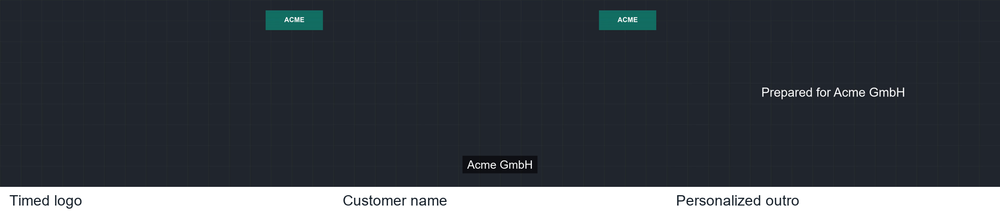

# Windows Batch Video Personalization — Executable Proof

This is a self-initiated, client-neutral proof for a Windows/Python/FFmpeg workflow. It is not presented as completed client work.



**Watch the rendered sample:** [ACME-001.mp4](output/ACME-001.mp4)

## What the customer can verify

**Input:** one master MP4, a CSV row per customer, and a logo image.  
**Action:** Python validates each row and builds an explicit FFmpeg render graph.  
**Output:** one H.264 MP4 per customer with timed logo, name overlay, and personalized outro.  
**Failure behavior:** bad rows are logged independently; valid completed files can be resumed without rerendering.

## Reproduce on Windows

```powershell
python -m pip install -r requirements.txt
python make_demo_assets.py
python render_batch.py
```

Run the second time to verify resume behavior:

```powershell
python render_batch.py
```

Expected result: two validated files in `output/`; the second run reports that both valid outputs were skipped.

## Evidence boundary

The included video and logos are synthetic. The code demonstrates the risky parts of the proposed first milestone: safe local batch execution, CSV validation, timed FFmpeg composition, deterministic outputs, readable row-level errors, and resumability. A production version would extend `template.json` to expose all timing, position, typography, animation, codec, and packaging options agreed with the customer.
